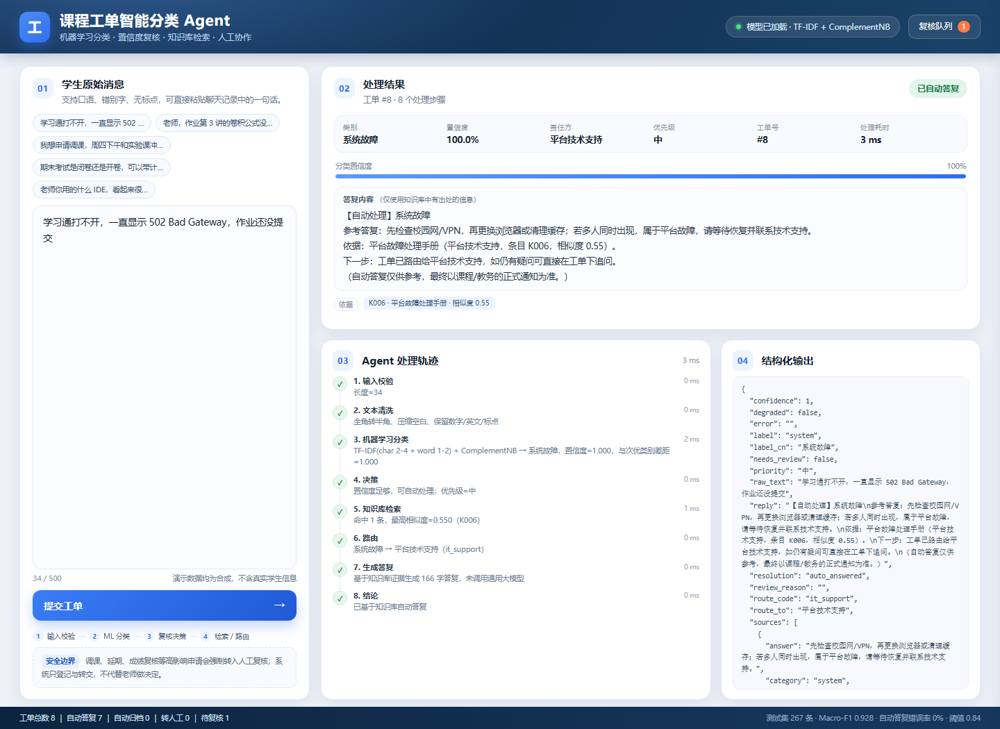
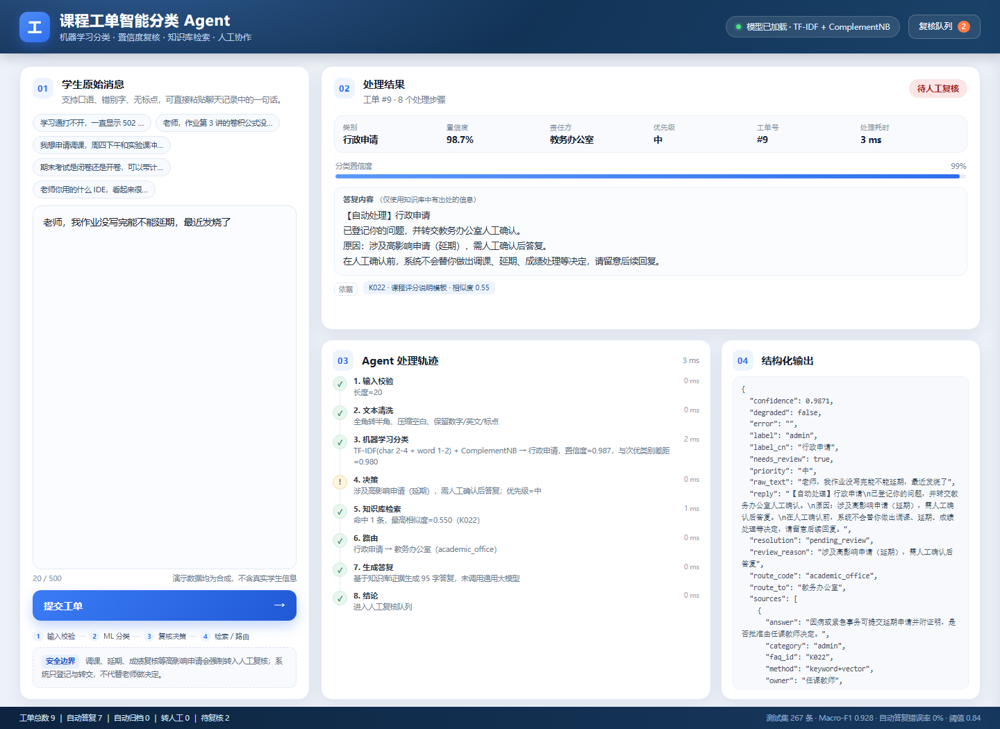

# 课程工单智能分类 Agent

> 《机器学习》课程期末项目 · 网页版原型  
> 一个面向“课程群答疑 / 教务工单”的端到端 Agent：**机器学习分类 + 置信度复核 + 知识库检索 + 人工协作**。

---

## 1. 项目解决什么问题

课程群和教学平台每天会产生大量学生消息：作业不会做、平台打不开、考试安排、调课/延期申请，以及聊天灌水。助教需要逐条阅读、判断类型、转发给对应负责人，重复劳动多、响应慢、易漏消息。

本项目把这件事拆成一个可运行的 Agent：

- **输入**：学生在课程群/平台里的一句话（口语、错别字、无标点均可）；
- **输出**：5 类工单标签 + 置信度 + 责任方 + 优先级 + 有出处的答复/转人工说明 + 可审计的处理轨迹；
- **边界**：低置信度、类别歧义、高影响申请（调课、延期、成绩复核等）一律转人工，不自动做决定。

五类工单：`作业疑问 / 系统故障 / 考试咨询 / 行政申请 / 无关灌水`。

## 2. 快速开始

环境：Windows / macOS / Linux，Python 3.10+（开发验证使用 Python 3.12.6）。

```bash
# 1) 安装依赖
pip install -r requirements.txt

# 2) 生成合成数据集与 FAQ 知识库（约 1 秒）
python -m src.data_gen --seed 42

# 3) 训练、调阈值、评估（约 10 秒）
python -m src.train

# 4) 端到端评估 + 消融实验
python -m src.evaluate

# 5) 生成图表
python -m src.make_figures

# 6) 启动网页原型
python -m src.webapp --open
# 浏览器访问 http://127.0.0.1:8000
```

Windows 下也可以直接双击 `run_web.bat`（自动安装依赖 → 检查模型 → 启动网页）。

首次运行 `src.train` 会生成 `models/classifier.joblib`；若模型不存在，网页会提示先训练。

### 在 GitHub Codespaces 中在线运行

GitHub 仓库页面本身不能执行 Flask 后端，但可以用仓库自带的 Codespaces 起一个临时在线演示：

1. 打开仓库 → `Code` → `Codespaces` → `Create codespace on main`（`.devcontainer` 会自动安装依赖）；
2. 在下方终端执行：
   ```bash
   python -m src.webapp --host 0.0.0.0 --port 8000
   ```
3. 打开 `PORTS` 面板，找到 8000 端口，右键 → `Port Visibility` → `Public`；
4. 复制生成的 `https://<codespace>-8000.app.github.dev` 地址，即可在浏览器访问；
5. 把该地址填进报告附录 B 的“在线演示地址”。

注意：Codespace 停止后地址失效，演示/验收前先启动；免费额度用完会休眠。若需要长期稳定链接，改用 Hugging Face Spaces（Docker）或 Render 部署。

### 一键自检

```bash
python -m unittest discover -s tests -v
```

覆盖：数据规模与标签、模型加载、正常工单的轨迹与答复、空输入/噪声拒绝、高影响申请转复核、知识库命中、Web 接口。8 个用例应全部通过。

测试样例另见 `data/test_samples.csv`（12 条，含期望类别与结论）。六项验收要求的逐条对照见 `docs/验收对照表.md`。

## 3. 网页原型怎么用

1. 左侧输入一条学生消息（或点击示例标签）；
2. 点击“提交工单”，右侧展示：类别、置信度、责任方、优先级、工单号、答复与依据；
3. 下方展示 **8 步处理轨迹**（每一步的状态、耗时、说明）和完整 JSON；
4. 点击右上角“复核队列”，查看低置信度/高影响工单，可标记“已答复”或“关闭”；
5. 底部状态栏实时统计自动答复、转人工、待复核数量。

截图（`outputs/`）：





完整演示脚本见 `docs/演示说明.md`（3 个场景、预期结果与讲解要点）。

接口（Flask）：

| 方法 | 路径 | 说明 |
|---|---|---|
| POST | `/api/process` | `{"text": "..."}` → 结构化结果 |
| GET | `/api/stats` | 工单统计 |
| GET | `/api/reviews` | 待复核队列 |
| POST | `/api/reviews/<id>/resolve` | 人工处理（resolved / closed） |
| GET | `/api/samples` | 示例消息 |

## 4. 目录结构

```
campus_workorder_agent/
├─ src/
│  ├─ config.py          # 类别、路由表、阈值、高影响意图
│  ├─ data_gen.py        # 合成工单数据 + FAQ 知识库
│  ├─ preprocess.py      # 清洗、jieba 分词
│  ├─ baseline.py        # 关键词规则基线
│  ├─ train.py           # 特征、模型对比、阈值搜索、最终评估
│  ├─ tools.py           # 知识库混合检索、SQLite 工单库
│  ├─ agent.py           # Agent 工作流（校验→分类→复核→检索→路由→答复）
│  ├─ evaluate.py        # 端到端评估、消融、异常输入测试
│  ├─ make_figures.py    # 报告图表
│  └─ webapp.py          # Flask 网页服务
├─ web/                  # 前端页面（原生 HTML/CSS/JS，无外部 CDN）
├─ data/                 # tickets.csv、kb_faq.csv、test_samples.csv
├─ models/               # classifier.joblib、metadata.json
├─ outputs/              # 指标、预测明细、图表、截图、日志
├─ tests/                # test_smoke.py（8 个端到端冒烟测试）
├─ docs/                 # 验收对照表、复用组件清单
├─ report/               # 期末报告（docx / pdf）
├─ requirements.txt
└─ run_web.bat
```

## 5. 机器学习部分

- **任务**：中文短文本五分类（工单分类，对应课程“新闻/评论/工单分类”模块）。
- **特征**：双通道 TF-IDF
  - 字符 n-gram（2–4）：对错别字、口语缩写更稳健；
  - jieba 词 n-gram（1–2）：提供可解释的关键词证据。
- **模型对比**：ComplementNB / 线性 SVM（概率校准）/ 逻辑回归，在开发集上按 Macro-F1 选择 ComplementNB。
- **阈值**：在含边界难例的开发集上搜索置信度阈值，最小化运行成本（错误自动答复 ×4 + 人工复核 ×1），最终阈值 0.84。
- **知识库检索**：类别过滤 + 意图关键词 + TF-IDF 余弦相似度的混合检索，只返回有出处的 FAQ 条目。
- **答复生成**：模板化拼接知识库原文，不调用通用大模型，不编造政策。

测试集 267 条（其中 117 条为人工构造的边界难例）：

| 指标 | 结果 |
|---|---|
| 准确率 | 0.9288 |
| Macro-F1 | 0.9275 |
| 难例 Macro-F1 | 0.8384 |
| 规则基线 Macro-F1 | 0.8174 |
| 自动答复率 | 48.7%（其中实质答复 37.8%） |
| 自动答复错误率 | 0/130 |
| 错误捕获率（转人工拦住的错误） | 89.5% |
| 平均处理耗时 | 约 5.5 ms/条 |

完整数字见 `outputs/metrics.json`、`outputs/agent_eval.json`、`outputs/*.csv`。

## 6. 数据与隐私

- `data/tickets.csv` 全部由模板 + 槽位 + 口语变体合成，**不含任何真实学生姓名、学号、聊天记录**；
- `data/kb_faq.csv` 为课程/教务常见问题的通用说明模板，具体政策以学校当期通知为准；
- 网页工单库 `data/agent_tickets.db` 仅保存在本机，不对外上传；
- 演示截图中的人名、学号均为虚构或占位。

## 7. 复用组件与许可证

详见 `docs/复用组件清单.md` 与报告附录。核心依赖：

| 组件 | 版本 | 许可证 | 用途 |
|---|---|---|---|
| scikit-learn | 1.9.1 | BSD-3-Clause | TF-IDF、ComplementNB、SVM、LogisticRegression、评估指标 |
| jieba | 0.42.1 | MIT | 中文分词 |
| Flask | 3.1.3 | BSD-3-Clause | 本地 Web 服务与 JSON API |
| pandas / numpy | 3.1.1 / 2.5.5 | BSD-3-Clause | 数据处理与数值计算 |
| matplotlib | 3.11.2 | PSF/BSD 兼容 | 实验图表 |
| python-docx | 1.2.0 | MIT | 报告生成 |

本项目自行编写：数据构造、Agent 工作流、置信度复核策略、混合检索、SQLite 工单库、前端页面与全部实验脚本。

## 8. 已知限制

- 数据为合成数据，模板分布导致基础测试集接近饱和，**难例子集才是更有信息量的信号**；
- 知识库覆盖率有限（47.2% 工单能匹配到有出处的答案），其余转人工；
- 阈值只在 228 条开发集上选择，换到真实校园数据需要重新校准；
- 未接入真实大模型，答复为抽取式模板，表达自然度有限；
- 网页为教学原型：无登录、无鉴权、无限流，不应直接部署到公网。

## 9. 学术说明

本项目使用生成式 AI 辅助代码调试、文档排版与图表生成；数据、实验运行、指标与结论均由作者复核。运行 `python -m src.evaluate` 可复现全部数字。
