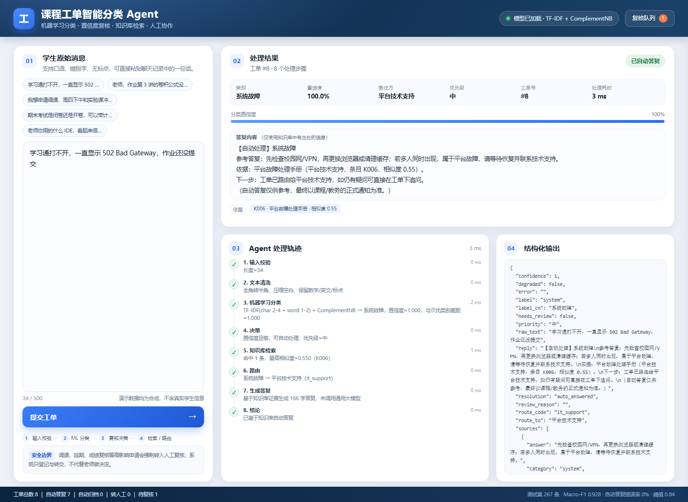
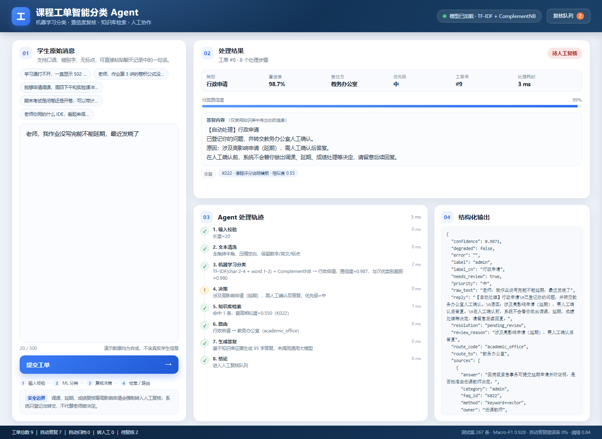

# 演示说明（60 秒版）

> 对应提交材料 ③“演示材料或可运行原型”。  
> 截图均为本机真实运行结果，未使用设计稿或伪造数据。

## 一、启动

```bash
pip install -r requirements.txt
python -m src.data_gen --seed 42
python -m src.train
python -m src.webapp --open
```

浏览器打开 `http://127.0.0.1:8000`。仓库已附训练好的 `models/classifier.joblib`，若只想看演示，可跳过前两步，直接启动网页。

## 二、场景 1：系统故障自动答复

输入：

```text
学习通打不开，一直显示 502 Bad Gateway，作业还没提交
```

预期结果：

- 类别：系统故障
- 置信度高于 0.84，进入自动答复
- 责任方：平台技术支持；优先级：高
- 答复引用 FAQ K006（学习通/平台故障），附来源与相似度
- 右侧轨迹显示 8 步，结论状态 `auto_answered`



## 三、场景 2：高影响申请强制人工复核

输入：

```text
老师，我作业没写完能不能延期，最近发烧了
```

预期结果：

- 类别可能是行政申请，置信度即使很高也不自动批准
- 结论状态 `pending_review`，原因为“高影响意图：延期”
- 答复只说明已转交，不承诺结果
- 右上角“复核队列”出现该工单，可标记已答复/关闭



## 四、场景 3：无答案不编造

输入：

```text
课程和考试冲突了怎么办
```

预期结果：分类置信度不足或无匹配 FAQ，转人工路由；系统不生成具体处理结论。这是报告中保留的已知边界错误案例（真实标签为行政申请，模型判为考试），用于说明“转人工兜底”而不是“自动答复正确”。

## 五、演示时建议讲的三句话

1. 模型只负责“类别 + 置信度”，不负责最终决定；
2. 知识库只返回有出处的原文，检索不到就转人工；
3. 调课、延期、成绩复核等高影响申请，置信度再高也强制人工确认。

## 六、可复现的自动检查

```bash
python -m unittest discover -s tests -v
```

8 个用例覆盖数据、模型、空输入/噪声拒绝、高影响复核、知识库命中与 Web 接口；正常应全部通过。
